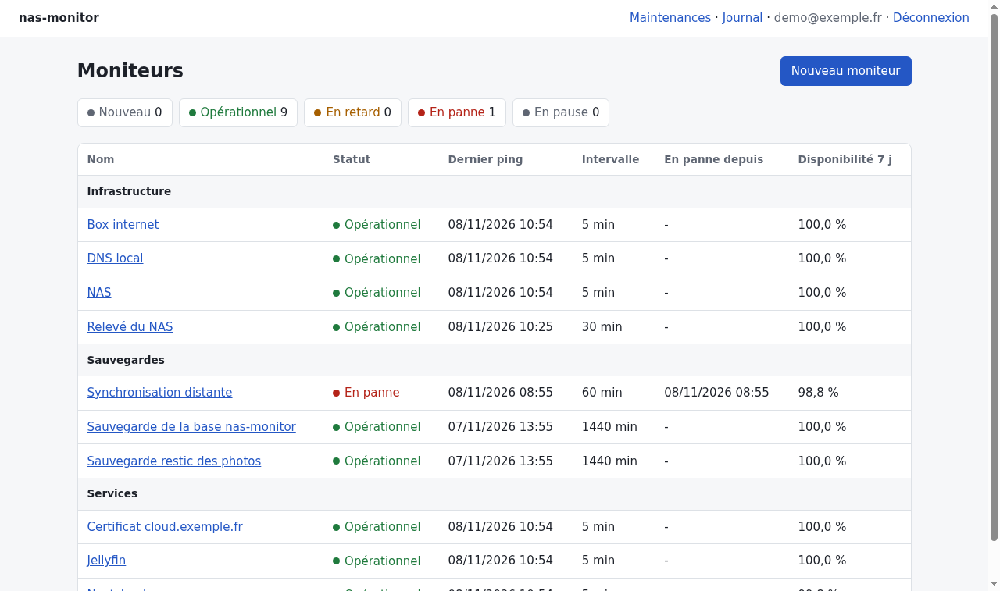
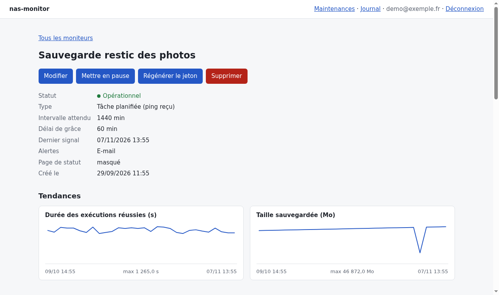
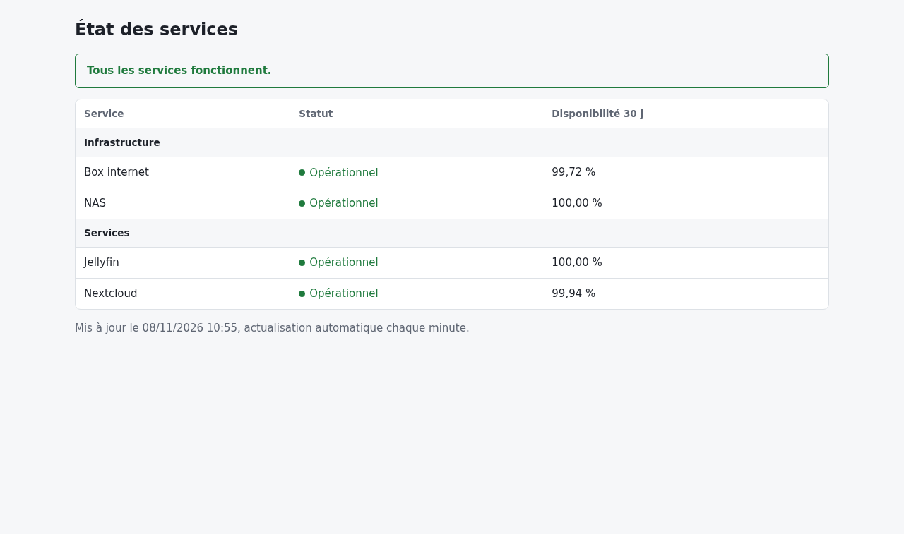

# nas-monitor

[](https://github.com/Remiverhaeghe/nas-monitor/actions/workflows/ci.yaml)

Supervision des sauvegardes et des tâches planifiées d'un NAS auto-hébergé.

Chaque tâche signale son exécution par un appel HTTP. L'application contrôle aussi elle-même des sites web, des ports TCP, des certificats TLS, la résolution DNS et la réponse au ping. Une page de statut publique, facultative, montre l'état des services choisis. Si un signal manque dans le délai prévu ou si un contrôle échoue, un incident est ouvert et une alerte est envoyée par e-mail ou par ntfy.

Stack : PHP 8.5, Symfony 8, PostgreSQL 16, FrankenPHP, Docker Compose. Basé sur [dunglas/symfony-docker](https://github.com/dunglas/symfony-docker).

## Aperçu

Captures réalisées avec des données de démonstration.







## Démarrage

Prérequis : Docker avec Docker Compose.

```bash
docker compose build --pull --no-cache
docker compose up --wait
docker compose exec php bin/console app:user:create admin@exemple.fr
```

L'application est disponible sur https://localhost (certificat local à accepter). Double authentification facultative : `bin/console app:user:totp-enable admin@exemple.fr`.

La vérification planifiée et l'envoi des e-mails passent par un worker :

```bash
docker compose exec php bin/console messenger:consume async scheduler_default -vv
```

En développement, les e-mails sont capturés par Mailpit, dont l'adresse s'obtient avec `docker compose port mailer 8025`.

## Signaler une exécution

Après création d'un moniteur, le tableau de bord affiche une seule fois son jeton. En fin de tâche :

```bash
curl -fsS -m 10 --retry 3 -X POST https://<hôte>/ping/<jeton>
```

`/ping/<jeton>/start` marque le début, `/ping/<jeton>/fail` un échec. Un corps JSON facultatif précise `duration_ms`, `size_bytes`, `message` et des `metrics` libres (`{"disk_used_percent": 82}`).

## API

Une API en lecture seule, destinée à l'application mobile, expose les moniteurs, leurs incidents et leurs pings :

```bash
docker compose exec php bin/console app:api-token:create admin@exemple.fr telephone
curl -H "Authorization: Bearer <jeton>" https://<hôte>/api/monitors
```

## Tests et qualité

```bash
docker compose exec php bin/phpunit
docker compose exec -e XDEBUG_MODE=coverage php bin/phpunit --coverage-text --only-summary-for-coverage-text
docker compose exec -e XDEBUG_MODE=coverage php vendor/bin/infection --threads=1
```

Infection modifie le code métier (`src/Entity`, `src/Service`, `src/Check`, `src/Chart`, `src/Report`, `src/Security`) et vérifie que les tests détectent chaque modification ; la CI exige 85 %.

```bash
docker compose exec php vendor/bin/phpstan analyse
docker compose exec php vendor/bin/php-cs-fixer fix --dry-run --diff
```

Les tests utilisent la base `app_test`, à créer une fois :

```bash
docker compose exec php bin/console doctrine:database:create --env=test
docker compose exec php bin/console doctrine:migrations:migrate --env=test --no-interaction
```

La suite comprend des parcours dans un vrai navigateur (Panther et Chromium, présents dans l'image de développement). Ils vérifient que les pages s'affichent sans violation de la CSP. Les captures de cette page ne font pas partie de la suite par défaut, pour les régénérer :

```bash
docker compose exec php bin/phpunit --group screenshots
```

## Configuration

| Variable | Rôle |
|---|---|
| `ALERT_EMAIL_FROM` | Expéditeur des alertes |
| `ALERT_EMAIL_TO` | Destinataire des alertes |
| `MAILER_DSN` | Serveur d'envoi des e-mails |
| `NTFY_URL`, `NTFY_TOKEN` | Sujet ntfy et jeton facultatif, vide pour désactiver |
| `HEARTBEAT_URL` | Service extérieur prévenu toutes les 5 minutes, vide pour désactiver |
| `PING_RETENTION_DAYS` | Durée de conservation des pings (90 par défaut) |
| `AUDIT_RETENTION_DAYS` | Durée de conservation du journal des actions (365 par défaut) |
| `TLS_WARNING_DAYS` | Délai d'alerte avant expiration d'un certificat (14 par défaut) |
| `TRUSTED_PROXIES` | Adresses des proxys inverses de confiance, vide par défaut |
| `TOTP_ENCRYPTION_KEY` | Clé de chiffrement des secrets TOTP, 32 octets en base64, obligatoire en production : `php -r 'echo base64_encode(random_bytes(32)), PHP_EOL;'` |
| `ANOMALY_SIZE_DROP_PERCENT`, `ANOMALY_DURATION_FACTOR` | Seuils de détection d'un résultat anormal (50 % et 3 par défaut) |
| `ALERT_REMINDER_HOURS` | Rappel d'une panne toujours en cours (6 h par défaut, 0 pour désactiver) |
| `DB_BACKUP_PING_URL`, `DB_BACKUP_INTERVAL_SECONDS`, `DB_BACKUP_KEEP` | Sauvegarde de la base en production, voir [docs/sauvegarde.md](docs/sauvegarde.md) |
| `DATABASE_URL` | Connexion PostgreSQL, fournie par `compose.yaml` |
| `CADDY_MERCURE_JWT_SECRET`, `CADDY_MERCURE_PUBLIC_URL` | Clé des jetons Mercure (obligatoire en production) et URL publique du hub si elle diffère de `https://<SERVER_NAME>:<HTTPS_PORT>` |

Les valeurs propres à une installation vont dans `.env.local`, non versionné.

## Documentation

| Fichier | Contenu |
|---|---|
| [docs/fonctionnalites.md](docs/fonctionnalites.md) | Statuts, incidents, écrans et commandes |
| [docs/architecture.md](docs/architecture.md) | Organisation du code et flux principaux |
| [docs/securite.md](docs/securite.md) | Protections en place |
| [docs/simulation.md](docs/simulation.md) | Simulation locale du NAS avec tâches de sauvegarde |
| [docs/sauvegarde.md](docs/sauvegarde.md) | Sauvegarde et restauration de la base |
| [docs/nas.md](docs/nas.md) | Relevé de l'état du NAS, dépendances, contrôles ICMP et DNS |
| [CHANGELOG.md](CHANGELOG.md) | Évolutions |

## Licence

MIT
